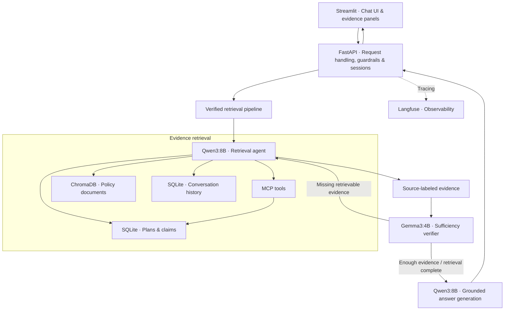
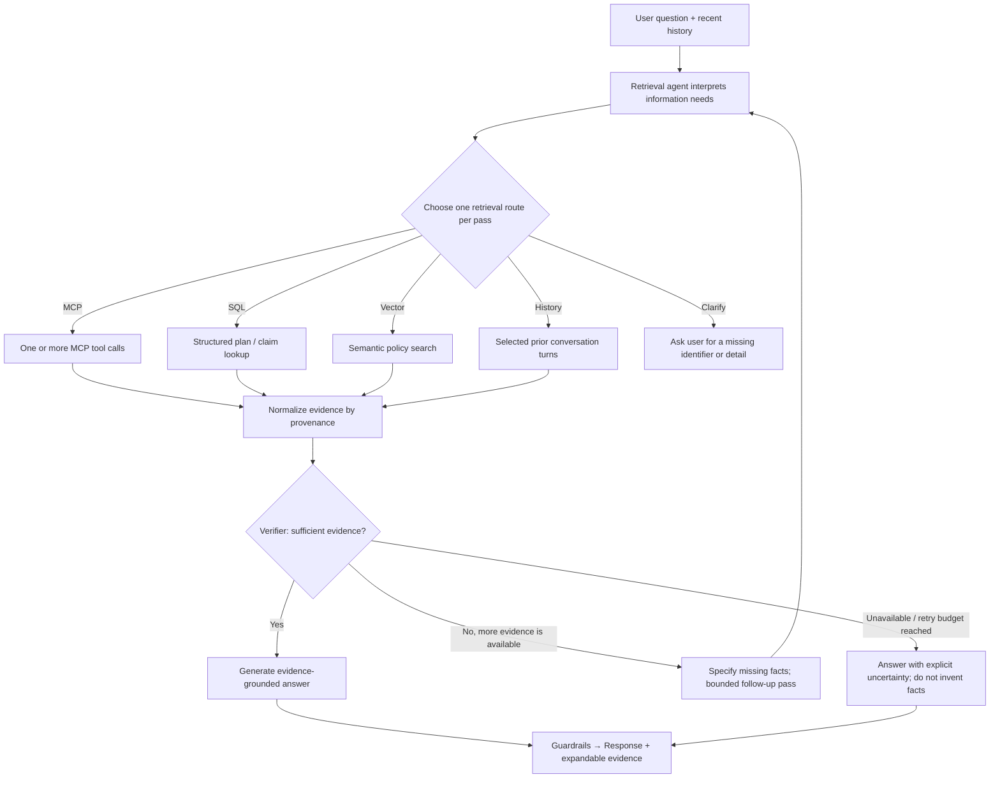

# Cohort Insurance Chatbot

**This chatbot is an evidence-first, agentic RAG assistant for a fictional health-insurance company.** The initial scaffold was built during the #ABTalksAI Learning Cohort to demonstrate tool-calling agents, structured and semantic retrieval, and local LLM orchestration. I subsequently extended it with agentic evidence verification and operational diagnostics.

*The application uses synthetic plan, claim, and policy data. It is a technical demonstration, not a real insurer, a source of personalized coverage decisions, or medical advice.*

## 1. Project Overview

The chatbot answers questions about three fictional insurance plans: **Gold PPO, Silver HMO, and Bronze HMO** with a small set of associated claims. Users can look up premiums and deductibles, compare plan records, check claim statuses, ask about policy procedures, and continue a conversation with follow-up questions.

Unlike conventional RAG, this system uses an **LLM-driven retrieval agent** to select an appropriate evidence source for each pass. A separate verifier checks whether the gathered evidence is sufficient before the answer is generated. When necessary, verification can initiate a bounded follow-up retrieval.

The project demonstrates a complete, traceable, and multi-component AI application that follows an important principle of RAG: **a plausible answer is not the same as an answer supported by the available data**. This chatbot follows constraint when the ground truth is not available.

## 2. Architecture & Key Features

### Application architecture



### Agentic retrieval workflow



**What distinguishes this implementation:**

- **Intent-aware retrieval:** Qwen3 chooses among MCP tools, direct SQL lookups, ChromaDB searches, conversation history, and clarification, rather than relying on a keyword router. Each retrieval pass selects one route; an MCP route may issue multiple tool calls.
- **Evidence sufficiency loop:** A smaller Gemma3 verifier checks requested entities, fields, relationships, and answer completeness. It can request additional retrieval without becoming the primary retrieval agent.
- **Grounded responses:** Retrieved MCP outputs, SQL rows, and policy passages are kept distinguishable so the answer model can avoid treating unrelated passages as verified facts.
- **Conversational memory:** Recent exchanges are loaded from SQLite, and longer histories are compressed to keep prompts manageable. Questions about earlier conversations can use a dedicated history route.
- **Inspectability and guardrails:** The Streamlit UI shows expandable tool-call results and policy chunk references. The backend also applies input/output validation, PII redaction, and request throttling.
- **Operational instrumentation:** Langfuse tracing hooks and Ollama context diagnostics are included; observability and container orchestration are part of the final deployment validation.

**Implementation map:** [`app.py`](app.py) (UI) → [`coverage-chatbot-api/main.py`](coverage-chatbot-api/main.py) (API) → [`agent_verifier.py`](agent_verifier.py) (verification and retry) → [`langchain_agent.py`](langchain_agent.py) (retrieval, memory, answer generation) → [`mcp_server.py`](mcp_server.py) (MCP endpoints). Earlier cohort experiments remain in the repository under `/old_files` as an artifact of previous experimentation and failures.

**Evaluation and validation:** The example questions below exercise single- and multi-record retrieval, policy lookup, evidence sufficiency, and follow-up context. Local Kubernetes deployment is validated separately by checking Pod readiness and testing the chat interface; healthy Pods alone do not demonstrate answer correctness. This README does not claim a benchmark improvement without a corresponding reproducible evaluation.

## 3. Supported Questions & Example Scenarios

### Fictional insurance environment

The chatbot operates on a small, fixed dataset; the names and IDs below are for **testing**, not real policies or customers. This table reflects the included [`data/plans.csv`](data/plans.csv):

| Plan ID | Plan | Monthly premium | Annual deductible | Copay field | Coverage type |
|---|---|---:|---:|---:|---|
| `P101` | Gold PPO | $500 | $2,000 | 10% | PPO |
| `P102` | Silver HMO | $300 | $1,500 | 20% | HMO |
| `P103` | Bronze HMO | $150 | $1,000 | 30% | HMO |

Claims in [`data/claims.csv`](data/claims.csv) have IDs such as `C1002` (**Approved**) and `C1003` (**Denied**), along with claim amounts, procedures, plan IDs, and filing dates. Policy and process documents are stored separately and queried through semantic retrieval. The interface's demo account identifier is **not** a real authentication mechanism or proof of membership in one of these plans.

### Test my work!

Start with the first few prompts, then try combined and multi-record questions. The table describes the **expected capabilities being exercised** and does not guarantee a specific internal route. The examples are based on the included dataset and prior testing.

| # | Ask the chatbot | What it exercises |
|---:|---|---|
| 1 | **What is the monthly premium for plan P101?** | Single-plan structured lookup |
| 2 | **What are the coverage type and annual deductible of plan P102?** | Multiple fields from one structured record |
| 3 | **What is the status of claim C1003?** | Claim-status retrieval; expected status: *Denied* |
| 4 | **What is the status of claim C1002?** | Another claim lookup; expected status: *Approved* |
| 5 | **Compare the monthly premiums of plans P101 and P102.** | Multi-plan comparison; may require additional evidence |
| 6 | **What are the statuses of claims C1002 and C1003?** | Multi-record retrieval; may involve multiple MCP calls |
| 7 | **How can I appeal a denied claim?** | Unstructured policy/process document retrieval |
| 8 | **Can I use an out-of-network doctor?** | Policy FAQ retrieval |
| 9 | **Is surgery explicitly covered under plan P101?** | Coverage-evidence check; an unknown result is valid if the documents do not establish coverage |
| 10 | **Does the denied claim C1003 prove that X-rays are excluded under P102?** | Evidence reasoning: historical denial does **not** by itself establish a plan exclusion |

## 4. Technical Stack & Getting Started

| Layer | Technology | Role |
|---|---|---|
| Frontend | Streamlit | Chat UI, examples, expandable retrieval evidence, status and warnings |
| API | FastAPI, Pydantic | Request validation, sessions, chat responses and errors |
| Agent orchestration | LangChain with MCP adapters | LLM-driven routing and MCP tool execution |
| Retrieval | Qwen3:8B, Gemma3:4B via Ollama | Evidence completeness checks and bounded retries, route selection, tool calling, final answers|
| Structured storage | SQLite | Plans, claims and conversation records |
| Semantic search | ChromaDB + `all-MiniLM-L6-v2` | Embedding-based policy/document search |
| Observability | Langfuse | Trace hooks for model and application activity |
| Packaging / orchestration | Docker Compose, Minikube / Kubernetes | Local containerized services and a two-tier Kubernetes application deployment |

### A. Local development — recommended for initial testing

The commands below target **Windows PowerShell** from the repository root. Install Python, [Ollama](https://ollama.com/), and the project's dependencies first. Use your existing virtual environment if already configured.

```powershell
# One-time environment setup
py -3.12 -m venv .venv
.\.venv\Scripts\python.exe -m pip install -r requirements.txt

# Pull models used by the active retrieval and verification pipeline
ollama pull qwen3:8b
ollama pull gemma3:4b
```

Ensure the Ollama service is running via `ollama serve` or using the Ollama desktop application. The MCP subprocess is launched by the application when needed; you do **not** have to start `mcp_server.py` manually.

**Terminal 1 — FastAPI:**

```powershell
.\.venv\Scripts\python.exe -m uvicorn main:app --app-dir coverage-chatbot-api --host 127.0.0.1 --port 8765
```

**Terminal 2 — Streamlit:**

```powershell
$env:BACKEND_URL = "http://127.0.0.1:8765"
.\.venv\Scripts\python.exe -m streamlit run app.py
```

Open **http://localhost:8501**. Verify API connectivity independently:

```powershell
Invoke-RestMethod http://127.0.0.1:8765/health
```

Adjust `BACKEND_URL` if you choose another port. **Configure optional Langfuse credentials locally, never in source control**.

### B. Docker Compose — local containers and supporting services

The repository includes [`Dockerfile`](Dockerfile), [`Dockerfile.frontend`](Dockerfile.frontend), and [`docker-compose.yml`](docker-compose.yml). The main Compose stack defines **Streamlit**, **FastAPI**, and **Ollama**. It is useful for running the application without Kubernetes or for keeping Ollama available while Minikube hosts the frontend and backend.

From the repository root in **PowerShell**, start the standalone Compose application if you want to run without Kubernetes:

```powershell
docker compose up -d --build
docker compose ps
```

The Compose application exposes the frontend at **http://localhost:8502** and the backend at **http://localhost:8766**. Ollama is mapped to host port **11435**. These are **not** the Kubernetes frontend and backend endpoints.

Langfuse has a separate development stack in [`docker-compose.langfuse.yml`](docker-compose.langfuse.yml):

```powershell
docker compose -f docker-compose.langfuse.yml up -d
```

Its UI is at **http://localhost:3000**. Set non-default credentials and any tracing-related configuration in ignored local environment files; never commit secrets. Confirm a fresh chatbot interaction creates a trace before claiming end-to-end trace ingestion.

### C. Minikube / Kubernetes — local deployment

The [`k8s/`](k8s/) directory contains the backend and frontend **Deployments** and **Services** used for the completed local Kubernetes deployment. This is a **hybrid local setup**: Kubernetes runs the application containers, while **Ollama and Langfuse remain outside the cluster**, hosted by Docker Compose. It is not a public cloud deployment.

| Component | Runs in | Access / configuration |
|---|---|---|
| Streamlit frontend | Minikube (1 Pod) | `frontend` NodePort Service, port `8501` / NodePort `30501` |
| FastAPI backend | Minikube (1 Pod) | Internal `backend` ClusterIP Service at `http://backend:8000` |
| Ollama | Docker Compose on host | Host port `11435`; backend uses `http://host.minikube.internal:11435` |
| Langfuse | Separate Docker Compose stack | Host port `3000`; backend manifest uses `http://host.docker.internal:3000` |

The backend Deployment uses `/health` readiness and liveness probes and reads configuration from a Kubernetes Secret named **`backend-secrets`**. The manifests use the local image tags `abtalksai-cohort-backend:k8s-20261028` and `abtalksai-cohort-frontend:k8s-20261028` with `imagePullPolicy: Never`, so **both images must exist inside Minikube**.

#### 1. Start prerequisites (Windows PowerShell)

Install **Docker Desktop, Minikube, and kubectl**. Start Docker Desktop before running these commands. Execute them from the repository root:

```powershell
# Start the local cluster and select its Kubernetes context.
minikube start --driver=docker
kubectl config use-context minikube
minikube status
kubectl get nodes

# Start host-side dependencies (do not start duplicate frontend/backend
# Compose services when testing the Kubernetes application).
docker compose up -d ollama
docker compose -f docker-compose.langfuse.yml up -d

# Confirm that Ollama is reachable on the host.
curl.exe -f http://127.0.0.1:11435/api/tags
```

If the required models are not already present in the **Compose Ollama container**, pull them there (a host-installed Ollama instance may use a different model store):

```powershell
docker compose exec ollama ollama pull qwen3:8b
docker compose exec ollama ollama pull gemma3:4b
```

#### 2. Configure the backend Secret

The backend requires `backend-secrets`, created from your local, untracked `.env` file containing the applicable backend environment variables:

```powershell
kubectl get secret backend-secrets

# Only if the Secret does not exist:
kubectl create secret generic backend-secrets --from-env-file=.env
```

Creating this Secret imports entries from `.env` into Kubernetes; **inspect that file before using it**, keep it out of Git, and do not put real credentials into manifests. If configuration changes later, update the Secret and restart the backend Deployment so the new environment values are loaded.

#### 3. Build the images inside Minikube

For a first deployment, or when an image must be rebuilt, run:

```powershell
minikube image build -t abtalksai-cohort-backend:k8s-20261028 -f Dockerfile .
minikube image build -t abtalksai-cohort-frontend:k8s-20261028 -f Dockerfile.frontend .

# Verify the pinned image tags exist in Minikube.
minikube image ls | Select-String 'abtalksai-cohort-(backend|frontend)'
```

#### 4. Deploy and check health

```powershell
kubectl apply -f .\k8s\
kubectl rollout status deployment/backend --timeout=180s
kubectl rollout status deployment/frontend --timeout=180s
kubectl get pods,svc
```

Expect a **Ready** frontend Pod and backend Pod, a `frontend` NodePort Service on `30501`, and a `backend` ClusterIP Service on `8000`. `kubectl get pods,svc` documents the running resources, but the chatbot still needs an end-to-end functional check.

If `kubectl apply` reports that it cannot connect to an API server on `127.0.0.1`, check `minikube status`, then restore the existing cluster if needed:

```powershell
minikube stop
minikube start --driver=docker
kubectl get nodes
kubectl apply -f .\k8s\
```

Do **not** use `--validate=false` as a workaround for an unreachable Kubernetes API server.

#### 5. Open the Kubernetes frontend

Keep this command running in a **separate PowerShell window**:

```powershell
kubectl port-forward service/frontend 8503:8501
```

Open **http://localhost:8503**. This is the **Kubernetes deployment**; **http://localhost:8502** is the separate Docker Compose frontend. On Windows with the Docker driver, port-forwarding is a reliable local access method. `minikube service frontend --url` is another option, but may also require a terminal to remain open.

#### 6. Try it!

I encourage you to test my app. Check the answers against the synthetic DB records and any retrieved evidence displayed in the UI. Ask a follow-up such as **“Which plan has the lower deductible?”** to check conversation continuity. 

#### Troubleshooting and scope

```powershell
kubectl get pods -o wide
kubectl get services
kubectl get endpoints backend frontend
kubectl logs deployment/backend --tail=100
kubectl logs deployment/frontend --tail=100
kubectl describe deployment backend
```

**Scope:** This deployment demonstrates local Kubernetes orchestration, internal service discovery, health probes, environment-based configuration, and repeatable image builds. It intentionally uses **one backend replica** and **does not configure persistent Kubernetes volumes, image registry publishing, autoscaling, or public ingress**. Local session or database state may be lost when Pods are replaced; do not describe the system as production-ready or highly available.

---

*#ABTalksAI Learning Cohort project · Synthetic data and local models · For engineering demonstration and evaluation only.*
