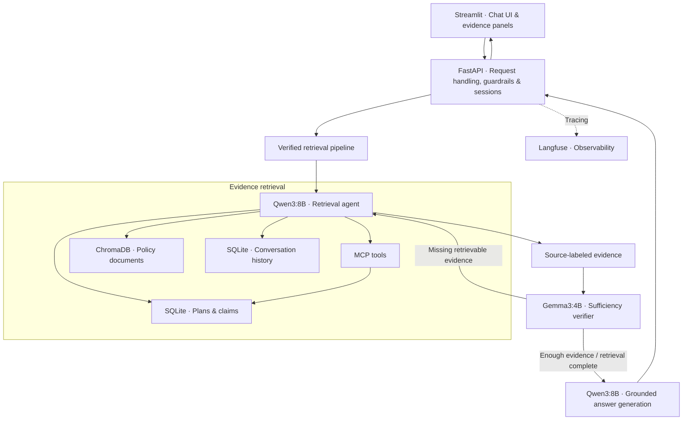
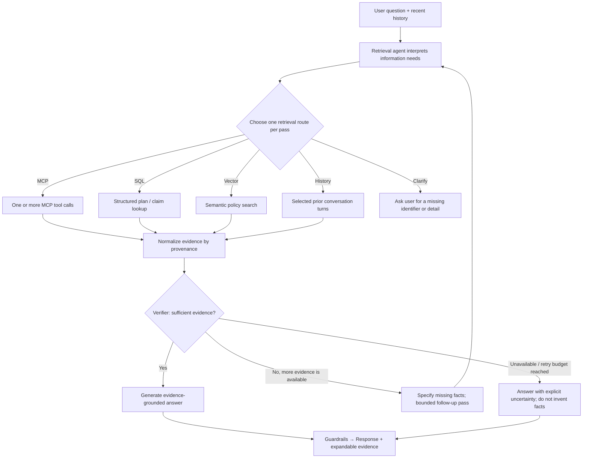

# Cohort Insurance Chatbot

**This chatbot is an evidence-first, agentic RAG assistant for a fictional health-insurance company.** This code's scaffold was built during the ABTalks AI Learning Cohort to demonstrate tool-calling agents, structured + semantic retrieval, and local LLM orchestration. It was later improved and finished by implementing agentic evidence verification

*The application uses synthetic plan, claim, and policy data. It is a technical demonstration that does not represent not a real insurer, a source of personalized coverage decisions, or medical advice.*

## 1. Project Overview

The chatbot answers questions about three fictional insurance plans: **Gold PPO, Silver HMO, and Bronze HMO** with a small set of associated claims. Users can look up premiums and deductibles, compare plan records, check claim statuses, ask about policy procedures, and continue a conversation with follow-up questions.

Unlike conventional RAG, this system uses an **LLM-driven retrieval agent** to select an appropriate evidence source for each pass. A separate verifier checks whether the gathered evidence is sufficient before the answer is generated. When necessary, verification can initiate a bounded follow-up retrieval.

The project demonstrates a complete, traceable, and multi-component AI application that follows the golden rule of RAG: **a plausible answer is not the same as an answer supported by the available data**. This chatbot follows its constraints when the ground truth is not available.

## 2. Architecture & Key Features

### Application architecture



### Agentic retrieval workflow



**What distinguishes this implementation:**

- **Intent-aware retrieval:** Qwen3 chooses among MCP tools, direct SQL lookups, ChromaDB searches, conversation history, and clarification, rather than relying on a keyword router. Each retrieval pass selects one route; an MCP route may issue multiple tool calls.
- **Evidence sufficiency loop:** A smaller Gemma3 verifier checks requested entities, fields, relationships, and answer completeness. It can request additional retrieval without becoming the primary retrieval agent.
- **Grounded responses:** Retrieved MCP outputs, SQL rows, and policy passages are kept distinguishable so the answer model can avoid treating unrelated passages as verified facts.
- **Conversational memory:** Recent exchanges are loaded from SQLite, and longer histories are compressed to keep prompts manageable. Questions about earlier conversations can use a dedicated history route.
- **Inspectability and guardrails:** The Streamlit UI shows expandable tool-call results and policy chunk references. The backend also applies input/output validation, PII redaction, and request throttling.
- **Operational instrumentation:** Langfuse tracing hooks and Ollama context diagnostics are included; observability and container orchestration are part of the final deployment validation.

**Implementation map:** [`app.py`](app.py) (UI) → [`coverage-chatbot-api/main.py`](coverage-chatbot-api/main.py) (API) → [`agent_verifier.py`](agent_verifier.py) (verification and retry) → [`langchain_agent.py`](langchain_agent.py) (retrieval, memory, answer generation) → [`mcp_server.py`](mcp_server.py) (MCP endpoints). Earlier cohort experiments remain in the repository under `/old_files` as an artifact of previous experimentation and failures.

**Evaluation:** 

## 3. Supported Questions & Example Scenarios

### Fictional insurance environment

The chatbot operates on a small, fixed dataset; the names and IDs below are for **testing**, not real policies or customers. This table reflects the included [`data/plans.csv`](data/plans.csv):

| Plan ID | Plan | Monthly premium | Annual deductible | Copay field | Coverage type |
|---|---|---:|---:|---:|---|
| `P101` | Gold PPO | $500 | $2,000 | 10% | PPO |
| `P102` | Silver HMO | $300 | $1,500 | 20% | HMO |
| `P103` | Bronze HMO | $150 | $1,000 | 30% | HMO |

Claims in [`data/claims.csv`](data/claims.csv) have IDs such as `C1002` (**Approved**) and `C1003` (**Denied**), along with claim amounts, procedures, plan IDs, and filing dates. Policy and process documents are stored separately and queried through semantic retrieval. The interface's demo account identifier is **not** a real authentication mechanism or proof of membership in one of these plans.

### Test my work!

Start with the first few prompts, then try combined and multi-record questions. The table describes the **expected capabilities being exercised** and does not a guarantee a specific internal route. The examples are based on the included dataset and prior testing.

| # | Ask the chatbot | What it exercises |
|---:|---|---|
| 1 | **What is the monthly premium for plan P101?** | Single-plan structured lookup |
| 2 | **What are the coverage type and annual deductible of plan P102?** | Multiple fields from one structured record |
| 3 | **What is the status of claim C1003?** | Claim-status retrieval; expected status: *Denied* |
| 4 | **What is the status of claim C1002?** | Another claim lookup; expected status: *Approved* |
| 5 | **Compare the monthly premiums of plans P101 and P102.** | Multi-plan comparison; may require additional evidence |
| 6 | **What are the statuses of claims C1002 and C1003?** | Multi-record retrieval; may involve multiple MCP calls |
| 7 | **How can I appeal a denied claim?** | Unstructured policy/process document retrieval |
| 8 | **Can I use an out-of-network doctor?** | Policy FAQ retrieval |
| 9 | **Is surgery explicitly covered under plan P101?** | Coverage-evidence check; an unknown result is valid if the documents do not establish coverage |
| 10 | **Does the denied claim C1003 prove that X-rays are excluded under P102?** | Evidence reasoning: historical denial does **not** by itself establish a plan exclusion |

## 4. Technical Stack & Getting Started

| Layer | Technology | Role |
|---|---|---|
| Frontend | Streamlit | Chat UI, examples, expandable retrieval evidence, status and warnings |
| API | FastAPI, Pydantic | Request validation, sessions, chat responses and errors |
| Agent orchestration | LangChain with MCP adapters | LLM-driven routing and MCP tool execution |
| Retrieval | Qwen3:8B, Gemma3:4B via Ollama | Evidence completeness checks and bounded retries, route selection, tool calling, final answers|
| Structured storage | SQLite | Plans, claims and conversation records |
| Semantic search | ChromaDB + `all-MiniLM-L6-v2` | Embedding-based policy/document search |
| Observability | Langfuse | Trace hooks for model and application activity |
| Packaging / orchestration | Docker Compose, Minikube / Kubernetes | Reproducible local deployment after configuration validation |

### A. Local development — recommended for initial testing

The commands below target **Windows PowerShell** from the repository root. Install Python, [Ollama](https://ollama.com/), and the project's dependencies first. Use your existing virtual environment if already configured.

```powershell
# One-time environment setup
py -3.12 -m venv .venv
.\.venv\Scripts\python.exe -m pip install -r requirements.txt

# Pull models used by the active retrieval and verification pipeline
ollama pull qwen3:8b
ollama pull gemma3:4b
```

Ensure the Ollama service is running via `ollama serve` or using the Ollama desktop application. The MCP subprocess is launched by the application when needed; you do **not** have to start `mcp_server.py` manually.

**Terminal 1 — FastAPI:**

```powershell
.\.venv\Scripts\python.exe -m uvicorn main:app --app-dir coverage-chatbot-api --host 127.0.0.1 --port 8765
```

**Terminal 2 — Streamlit:**

```powershell
$env:BACKEND_URL = "http://127.0.0.1:8765"
.\.venv\Scripts\python.exe -m streamlit run app.py
```

Open **http://localhost:8501**. Verify API connectivity independently:

```powershell
Invoke-RestMethod http://127.0.0.1:8765/health
```

Adjust `BACKEND_URL` if you choose another port. **Configure optional Langfuse credentials locally, never in source control**.

### B. Docker Compose — deployment verification pending

The repository contains [`Dockerfile`](Dockerfile), [`Dockerfile.frontend`](Dockerfile.frontend), and [`docker-compose.yml`](docker-compose.yml). The existing Compose configuration defines **frontend, backend, and Ollama** services, but has **not yet been revalidated against the finalized chatbot**. Docker-specific service names, Ollama connectivity, image startup, and data paths must pass an end-to-end test before a one-command deployment is advertised as reliable.

Langfuse's separate development stack is defined in [`docker-compose.langfuse.yml`](docker-compose.langfuse.yml). Confirm that the UI loads **and** that requests create real traces before considering this stage complete. Keep API keys, encryption keys, and other credentials out of committed YAML.

### C. Minikube / Kubernetes — deployment verification pending

The [`k8s/`](k8s/) directory includes backend/frontend Deployments and Services from the original cohort. Those manifests need a final configuration pass before reuse (notably Ollama networking, secrets, image tags, persistent data, and the backend replica count). **Kubernetes should deploy an already-working Docker image, not serve as the debugging environment.**

Final acceptance sequence: **local Python works → Docker Compose works → Langfuse records traces → Minikube deploys the same application successfully**. Once those stages pass, this section can be updated with the exact tested commands and access instructions.

---

*ABTalks AI Learning Cohort project · Synthetic data and local models · For engineering demonstration and evaluation only.*
